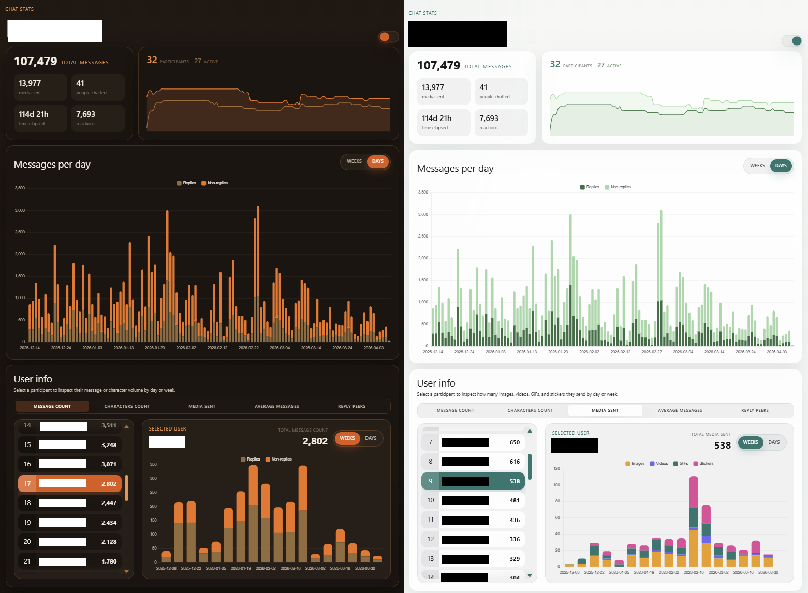

# Telegram Chat Analyzer

Small web app to explore Telegram group chat export data locally

## What it can do

- Show message activity over time by day or week
- Break down per-user stats for messages, characters, media, and average activity
- Surface reply relationships and favorite reply peers
- Highlight top messages by reactions and replies
- Inspect first-order replies for standout messages

## How to use
For now, by putting "result.json" from telegram chat export to the ./src/messages folder

## Dev

Install dependencies: `bun install`
Start a development server: `bun run dev`